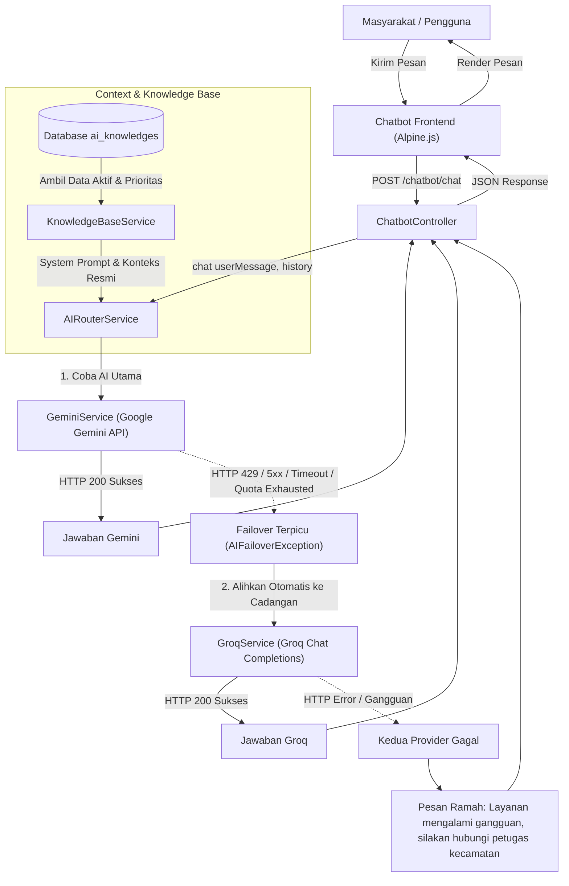

# DOKUMENTASI SISTEM DUAL AI PROVIDER GEMINI + GROQ
## Chatbot SIPAF — Kecamatan Cikampek

---

## 1. GAMBARAN UMUM SISTEM

Aplikasi web **SIPAF (Sistem Informasi Pengelolaan Peminjaman Fasilitas dan Pengajuan Sertifikat/Piagam Berbasis Web pada Kecamatan Cikampek)** dilengkapi dengan chatbot asisten digital untuk melayani pertanyaan masyarakat terkait layanan publik, peminjaman aula/inventaris, profil wilayah, dan administrasi kecamatan.

Untuk menjamin ketersediaan layanan (*high availability*), chatbot SIPAF menerapkan arsitektur **Dual AI Provider dengan Automatic Failover**:

### A. Google Gemini sebagai AI Utama (Primary Provider)
- **Prioritas Pertama:** Setiap pertanyaan yang diajukan masyarakat akan diproses oleh Google Gemini terlebih dahulu.
- **Karakteristik:** Google Gemini memiliki pemahaman konteks bahasa Indonesia yang sangat baik, kaya akan basis pengetahuan, dan terintegrasi secara native dengan *system instruction* resmi Kecamatan Cikampek.
- Selama kuota Gemini tersedia dan server Google tidak mengalami gangguan, 100% jawaban chatbot dihasilkan oleh Google Gemini.

### B. Groq sebagai AI Cadangan Otomatis (Fallback Provider)
- **Prioritas Kedua:** Groq hanya dipanggil saat Google Gemini mengalami kendala teknis yang memenuhi kriteria failover.
- **Karakteristik:** Groq Cloud dikenal memiliki mesin inferensi LPU (*Language Processing Unit*) dengan kecepatan sangat tinggi (*ultra-low latency*). Groq memproses model dengan format Chat Completions OpenAI-compatible.
- Groq menjamin masyarakat tetap mendapatkan jawaban akurat dan cepat tanpa merasakan bahwa provider utama sedang mengalami gangguan.

### C. Manfaat Automatic Failover bagi Pelayanan Publik
1. **Layanan Bebas Gangguan (Zero Downtime):** Layanan informasi publik tidak terhenti meskipun kuota harian/menit Gemini habis terkena *rate limit* (HTTP 429).
2. **Kenyamanan Masyarakat:** Warga tidak perlu mengetahui atau memilih provider secara manual; seluruh proses pengalihan berlangsung transparan di sisi server.
3. **Pemulihan Otomatis (Stateless Recovery):** Sistem tidak terkunci di provider cadangan. Begitu Google Gemini normal kembali pada request berikutnya, sistem otomatis kembali menggunakan Gemini.

---

## 2. ARSITEKTUR DAN ALUR KERJA SISTEM

### A. Alur Permintaan (Request Lifecycle)
1. Pengguna mengetik pertanyaan pada komponen chatbot web SIPAF.
2. Frontend mengirimkan request via POST ke route `/chatbot/chat`.
3. `ChatbotController` memvalidasi input dan meneruskannya ke `AIRouterService`.
4. `AIRouterService` meminta konteks knowledge base dan system prompt dari `KnowledgeBaseService`.
5. `AIRouterService` mencoba mengeksekusi `GeminiService`:
   - **Kasus Sukses:** Gemini mengembalikan jawaban (HTTP 200). Jawaban langsung dikirim kembali ke controller dan ditampilkan ke pengguna. Groq tidak dipanggil sama sekali.
   - **Kasus Failover:** Jika Gemini mengalami kuota habis (429), server error (5xx), timeout jaringan, atau kesalahan konfigurasi key, sistem melempar `AIFailoverException`.
6. `AIRouterService` menangkap failover dan secara otomatis mengeksekusi `GroqService` dengan prompt dan riwayat percakapan yang sama.
7. Jawaban dari Groq ditampilkan ke pengguna.
8. Jika kedua provider sama-sama gagal, sistem menampilkan pesan darurat yang ramah mengarahkan masyarakat menghubungi petugas kantor Kecamatan Cikampek.

### B. Diagram Alur Sistem (Mermaid Flowchart)



---

## 3. STRUKTUR DAN PENJELASAN FILE BACKEND

Struktur direktori service AI SIPAF:

```text
app/
├── Http/
│   └── Controllers/
│       └── ChatbotController.php
└── Services/
    └── AI/
        ├── AIRouterService.php
        ├── GeminiService.php
        ├── GroqService.php
        ├── KnowledgeBaseService.php
        └── Exceptions/
            ├── AIFailoverException.php
            └── AIServiceException.php
```

### 1. `app/Services/AI/AIRouterService.php`
- Bertindak sebagai konduktor utama perutean AI.
- Memastikan Gemini selalu dicoba pertama kali pada setiap permintaan baru (*stateless*).
- Menangkap `AIFailoverException` untuk melakukan pengalihan otomatis ke Groq.
- Menolak mengalihkan error klien yang tidak recoverable (seperti format input yang salah).
- Mencatat log operasional (nama provider, latency/durasi, kode status HTTP, dan alasan failover) tanpa mengekspos API key atau data pribadi pengguna.

### 2. `app/Services/AI/GeminiService.php`
- Menangani komunikasi HTTP dengan Google Gemini API (`https://generativelanguage.googleapis.com/v1beta/models/{model}:generateContent`).
- Memetakan peran percakapan: `user` dan `model`.
- Meneruskan `system_instruction` secara native ke Gemini.
- Mendeteksi kriteria error failover: HTTP 429, error `RESOURCE_EXHAUSTED`, HTTP 5xx, cURL/Connection Timeout, dan authentication error.
- Menerapkan batasan timeout dan retry terbatas (`max_retries`) agar server tidak menggantung.

### 3. `app/Services/AI/GroqService.php`
- Menangani komunikasi HTTP dengan Groq API (`https://api.groq.com/openai/v1/chat/completions`) menggunakan otentikasi `Bearer {GROQ_API_KEY}`.
- Memetakan format OpenAI Chat Completions:
  - Role `system`: memuat instruksi resmi dan konteks data kecamatan yang identik dengan Gemini.
  - Role `user`: pesan pengguna.
  - Role `assistant`: riwayat balasan bot sebelumnya (dikonversi dari role `model` Gemini).
- Mengelola parameter `temperature`, `max_tokens`, dan batasan timeout.

### 4. `app/Services/AI/KnowledgeBaseService.php`
- Mengambil data resmi dari model `AiKnowledge` yang berstatus aktif (`is_active = true`), diurutkan berdasarkan `priority DESC`.
- Menyusun *master system prompt* terpadu yang memuat:
  - Persona resmi Asisten Digital Kecamatan Cikampek.
  - Aturan tegas pengalihan layanan KTP/KK/Akta ke Gedung Mall Pelayanan Publik (MPP).
  - Data resmi BPS Karawang 2025: luas 10 desa (36,34 km²) dan demografi kependudukan (128.584 jiwa).
  - Aturan pencegahan halusinasi informasi (dilarang mengarang syarat, biaya, dan jadwal).
- Menyediakan metode `getEmergencyFallbackReply()` jika kedua provider AI gagal.

### 5. `app/Services/AI/Exceptions/AIFailoverException.php`
- Exception khusus untuk menandai kegagalan yang berhak dialihkan ke Groq (kuota habis, rate limit 429, timeout, gangguan server 5xx, masalah API key).

### 6. `app/Services/AI/Exceptions/AIServiceException.php`
- Exception umum untuk kegagalan teknis non-failover (misalnya parameter tidak valid).

### 7. `app/Http/Controllers/ChatbotController.php`
- Controller ramping (*thin controller*) yang bertugas:
  - Memvalidasi parameter request (`message` maksimal 500 karakter, `history` array).
  - Mendelegasikan pemrosesan ke `AIRouterService`.
  - Mengembalikan format JSON yang kompatibel 100% dengan frontend Alpine.js: `{ success: true, reply: "..." }` atau `{ success: false, message: "..." }`.

### 8. `config/services.php`
- Mendaftarkan konfigurasi `gemini`, `groq`, dan `ai` yang dibaca dari file `.env`.

---

## 4. KONFIGURASI ENVIRONMENT (.ENV)

Konfigurasi Dual AI dikelola melalui file `.env` di root direktori proyek SIPAF:

```env
# ========================================================
# GOOGLE GEMINI - PRIMARY AI
# ========================================================
GEMINI_API_KEY=your_gemini_api_key_here
GEMINI_MODEL=gemini-3.6-flash

# ========================================================
# GROQ - FALLBACK AI (CADANGAN OTOMATIS)
# ========================================================
GROQ_API_KEY=your_groq_api_key_here
GROQ_MODEL=qwen/qwen3.8-27b

# ========================================================
# AI ROUTER & FAILOVER CONFIGURATION
# ========================================================
AI_PRIMARY=gemini
AI_FALLBACK=groq
AI_TIMEOUT=20
AI_MAX_RETRIES=1
```

### Penjelasan Variabel:
- `GEMINI_API_KEY`: Kunci API Google Gemini yang diperoleh dari Google AI Studio.
- `GEMINI_MODEL`: Model Gemini yang aktif (misal: `gemini-3.6-flash`, `gemini-2.5-flash`, atau `gemini-1.5-flash`).
- `GROQ_API_KEY`: Kunci API Groq Cloud dari Groq Console.
- `GROQ_MODEL`: Model Groq yang aktif (misal: `qwen/qwen3.8-27b`, `llama-3.3-70b-versatile`, atau `llama-3.1-8b-instant`).
- `AI_PRIMARY`: Provider prioritas pertama (default: `gemini`).
- `AI_FALLBACK`: Provider prioritas cadangan (default: `groq`).
- `AI_TIMEOUT`: Batas waktu tunggu maksimal respons provider dalam detik (default: `20`).
- `AI_MAX_RETRIES`: Jumlah pengulangan percobaan request jika terjadi gangguan koneksi sesaat sebelum memutuskan failover (default: `1`).

> [!CAUTION]
> **PENTING:** Jangan pernah memasukkan file `.env` ke Git repository publik (seperti GitHub). Selalu pastikan file `.env` tercantum di dalam `.gitignore`.

---

## 5. HASIL PENGUJIAN OTOMATIS (TESTING VERIFICATION)

Pengujian unit dan integrasi otomatis dilakukan pada file `tests/Feature/SipafAiAssistantChatbotTest.php` dengan menggunakan HTTP Mocking (`Http::fake()`).

Hasil pengujian aktual pada sistem:

```text
   PASS  Tests\Feature\SipafAiAssistantChatbotTest
  ✓ gemini normal success does not call groq                                     0.35s  
  ✓ gemini rate limit 429 automatically fails over to groq                       0.05s  
  ✓ gemini server error 500 or 503 fails over to groq                            0.05s  
  ✓ gemini timeout or connection error fails over to groq                        0.05s  
  ✓ gemini recovery automatically resumes gemini on next request                 0.05s  
  ✓ both providers fail returns friendly error message                           0.05s  
  ✓ gemini receives knowledge base and preserves history                         0.03s  
  ✓ groq fallback receives same knowledge base and mapped history                0.03s  
  ✓ missing gemini api key falls over to groq                                    0.04s  
  ✓ invalid gemini api key falls over to groq                                    0.05s  
  ✓ request validation fails without calling any ai provider                     0.05s  
  ✓ non failover client error does not trigger groq                              0.04s  
  ✓ api keys are never leaked in any response                                    0.02s  

  Tests:    13 passed (49 assertions)
  Duration: 1.09s
```

Pengujian seluruh test suite aplikasi SIPAF:
- **Total Test:** 47 Passed
- **Total Assertions:** 158 Assertions
- **Total Failure:** 0 Failed (100% Lulus)

